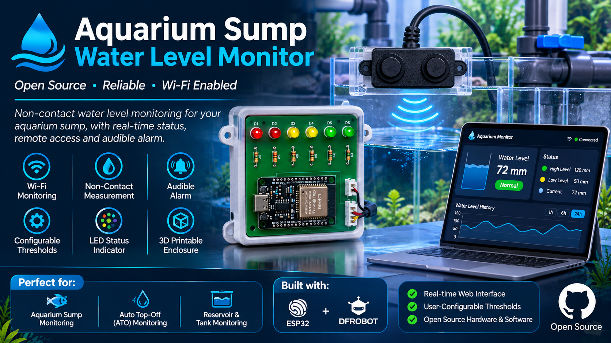
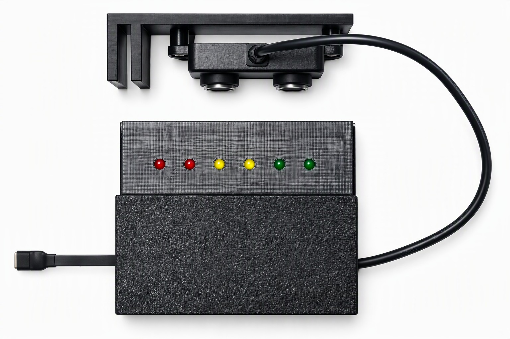
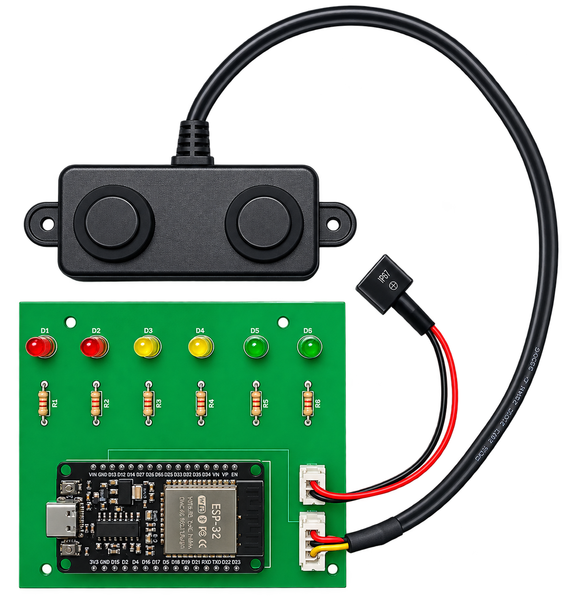
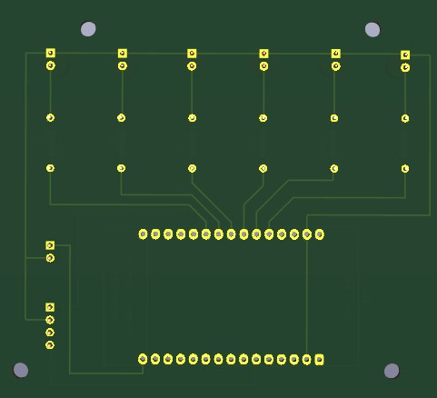

# Aquarium Water Level Monitor

## About

An open-source aquarium sump water level monitoring system built around the DFRobot A02YYUW waterproof ultrasonic sensor and an ESP32 microcontroller. The project provides reliable, non-contact water level measurement while keeping all electronics safely away from the water.

The system is specifically designed for aquarium sump installations and includes custom 3D-printable hardware for both the sensor mount and controller enclosure. Real-time water level status is displayed locally using green, yellow, and red LEDs, with an audible alarm to warn when the water level falls below a user-defined threshold.

Through its built-in web interface, users can monitor water levels remotely and configure operating parameters without modifying the source code. This helps aquarium owners detect abnormal sump conditions early and maintain consistent water levels for reliable operation of filtration and top-off systems.

## Features

Non-contact water level measurement
Waterproof DFRobot A02YYUW ultrasonic sensor
ESP32-based controller with Wi-Fi connectivity
Built-in web interface for monitoring and configuration
User-configurable high and low water level thresholds (millimeter resolution)
Green, yellow, and red LED status indication
Audible low-water-level alarm
Custom 3D-printable controller enclosure
Custom 3D-printable aquarium glass mounting bracket
PCB Design files ready to print
Designed specifically for aquarium sump installations
Open-source hardware and software

## Hardware

ESP32 development board
DFRobot A02YYUW waterproof ultrasonic sensor
RGB or individual status LEDs
Piezo buzzer
Custom PCB
3D-printed enclosure and sensor bracket

## Applications

Aquarium sump monitoring
Auto top-off (ATO) monitoring
Reservoir level monitoring
Water storage tank level monitoring
General non-contact liquid level measurement

## Assembled

<table align="center">
  <tr>
    <td align="center">
       
      Water Level Monitor
    </td>
    <td align="center">
       
      Water Level Monitor
    </td>
    <td align="center">
       
      Assembled Componets
    </td>
  </tr>
</table>

## PCB

<table align="center">
  <tr>
    <td align="center">
       
      PCB Top View
    </td>
    <td align="center">
       
      PCB Bottom View
    </td>
    <td align="center">
       
      PCB Layout
    </td>
    <td align="center">
       
      Schematic
    </td>
  </tr>
</table>

## 3D Printed Parts

## 🛒 Shopping List

| Item | Purchase Link |
|---|---|
| ESP32 ESP-WROOM-32 Development Board WiFi + Bluetooth | [Amazon](https://link.amazon/B0espH4Ix) |
| PCB Board - Send the  gerbers files in the PCB folder | [PCBWay](https://www.pcbway.com/) |
| Right Angle USB C Flat Extension Cable | [Amazon](https://link.amazon/B0bMhexuD) |
| Waterproof Ultrasonic Ranging Sensor | [Amazon](https://link.amazon/B0bCV0Zxt) |
| LED Light Kit Box - 5 Colors | [Amazon](https://link.amazon/B04djoovX) |
| 220 Ohm Resistor 1/2W (0.5 Watt) | [Amazon](https://link.amazon/B0dC10wjN) |
| DC 3-12V Active Electronic Buzzer | [Amazon](https://link.amazon/B0bWC1ZQ9) |
| JST Connector Kit 2.0mm - 2 and 4 Pin | [Amazon](https://link.amazon/B0aqEWpW9) |
| Self Tapping Screw M2x4 | [Amazon](https://link.amazon/B039ca9Il) |
| Bambu Lab PLA 3D Printer Filament 1.75mm RFID | [Amazon](https://link.amazon/B09fCrKce) |

> **Affiliate Disclosure:** Some of the links above are Amazon affiliate links. As an Amazon Associate, I may earn from qualifying purchases at no additional cost to you.

## License
This project is licensed under the MIT License - see the LICENSE file for details.

