# Aquarium Water Level Monitor

## About

An open-source aquarium sump water level monitoring system built around the DFRobot A02YYUW waterproof ultrasonic sensor and an ESP32 microcontroller. The project provides reliable, non-contact water level measurement while keeping all electronics safely away from the water.

The system is specifically designed for aquarium sump installations and includes custom 3D-printable hardware for both the sensor mount and controller enclosure. Real-time water level status is displayed locally using green, yellow, and red LEDs, with an audible alarm to warn when the water level falls below a user-defined threshold.

Through its built-in web interface, users can monitor water levels remotely and configure operating parameters without modifying the source code. This helps aquarium owners detect abnormal sump conditions early and maintain consistent water levels for reliable operation of filtration and top-off systems.

## Features

- Built-in web interface for monitoring and configuration
- User-configurable high and low level alarms with millimeter precision
- Green, yellow, and red LED water level status indicators
- Audible low-water-level alarm
- Optimized for aquarium tank or sump installations
- Non-contact water level measurement
- Waterproof DFRobot A02YYUW ultrasonic sensor
- Fully open-source hardware and software

## Hardware

- ESP32 development board
- DFRobot A02YYUW waterproof ultrasonic sensor
- RGB LEDs for water level status red, yellow, and green
- Piezo buzzer for audible alarms
- Custom Printed Circuit Board (PCB)

## Applications

- Aquarium sump water level monitoring
- Auto top-off (ATO) system monitoring
- Freshwater reservoir monitoring
- Water storage tank level monitoring
- General-purpose non-contact liquid level measurement

## Web Interface

<table align="center">
  <tr>
    <td align="center">
      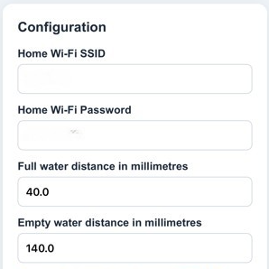 
      Configuration Page
    </td>
    <td align="center">
      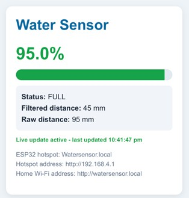 
      Tank Full
    </td>
    <td align="center">
      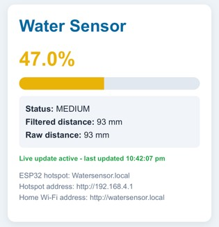 
      Tank Half Full
    </td>
    <td align="center">
      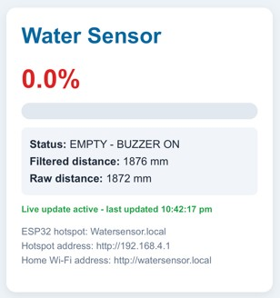 
      Tank Empty - Buzzer On
    </td>
  </tr>
</table>

## Assembled Project

<table align="center">
  <tr>
    <td align="center">
       
      Front View
    </td>
    <td align="center">
      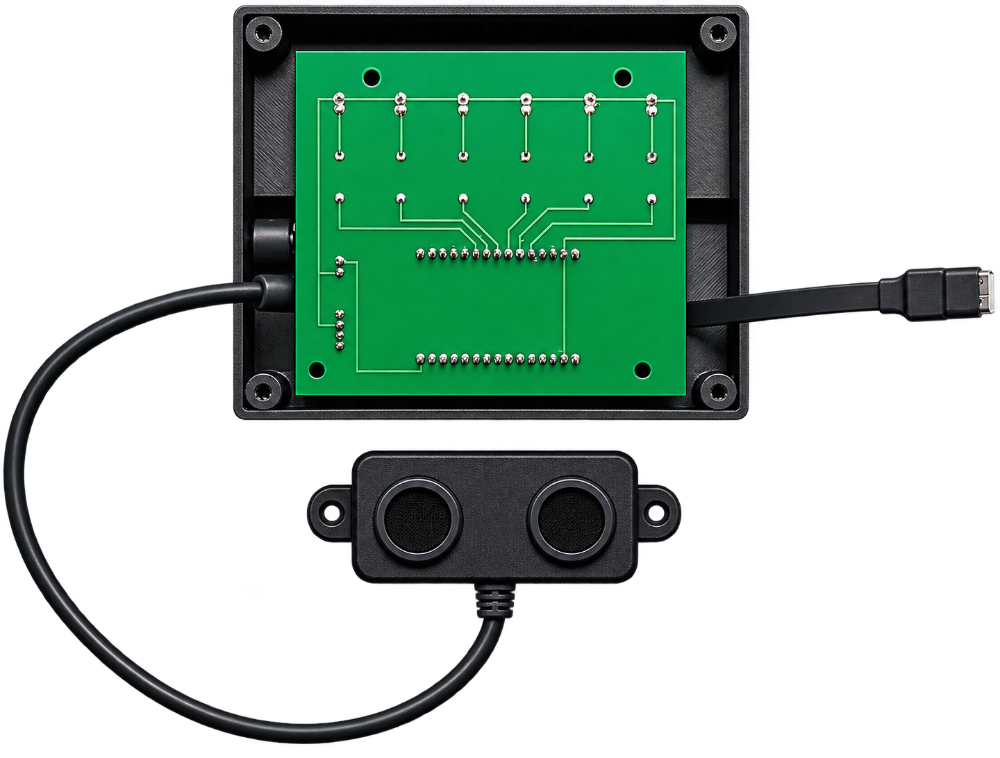 
      Back View
    </td>
    <td align="center">
       
      Assembled Componets
    </td>
  </tr>
</table>

## Printed Circuit Boad (PCB)

The PCB was designed using KiCad 10.0 Community Edition. All project source files are included in the PCB directory, allowing you to modify and adapt the design to suit your specific requirements.

<table align="center">
  <tr>
    <td align="center">
      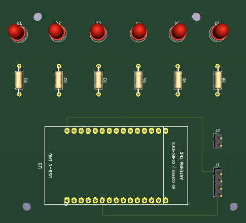 
      PCB Top View
    </td>
    <td align="center">
       
      PCB Bottom View
    </td>
    <td align="center">
      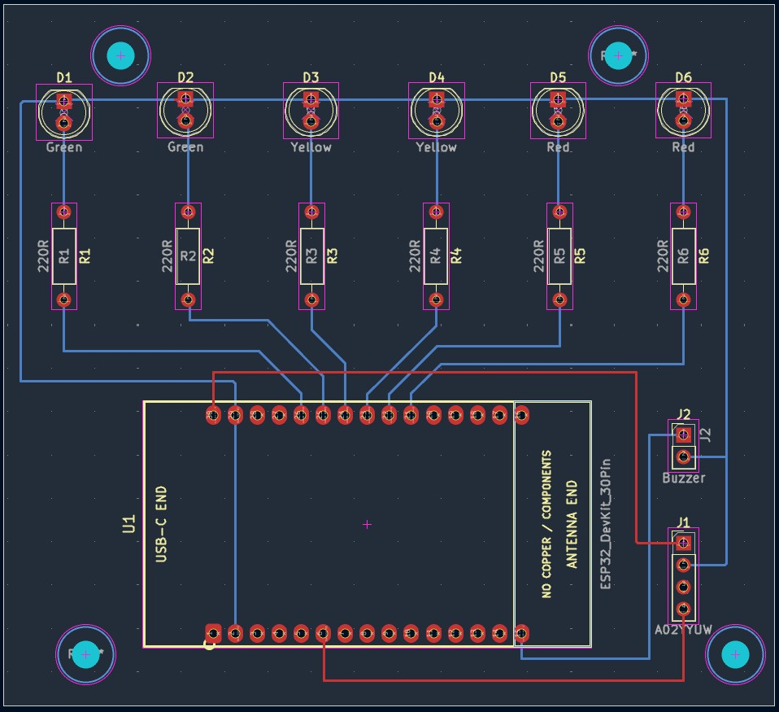 
      PCB Layout
    </td>
    <td align="center">
      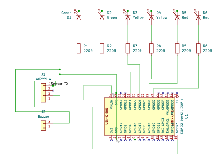 
      Schematic
    </td>
  </tr>
</table>

## 3D Printed Components

The enclosure and mounting components were printed on a Bambu Lab P1S using Bambu Lab Basic PLA, with Bambu Lab Support Material employed for the interface layers to improve surface quality and ease support removal. Both the STL files and the original 3MF project files are included in the STL directory, enabling straightforward printing and easy customization of print settings.

<table align="center">
  <tr>
    <td align="center">
      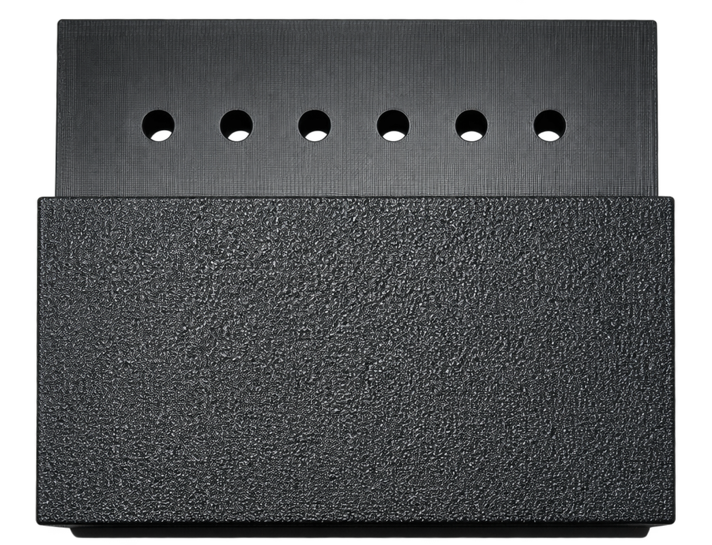 
      Front View
    </td>
    <td align="center">
      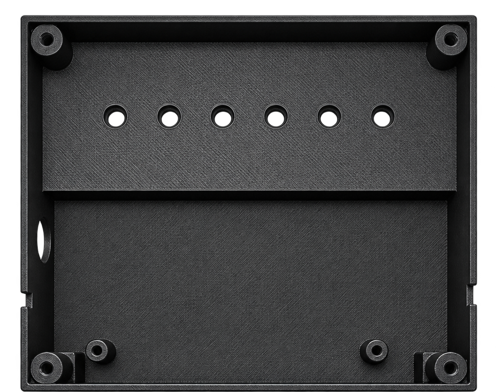 
      Back View
    </td>
    <td align="center">
      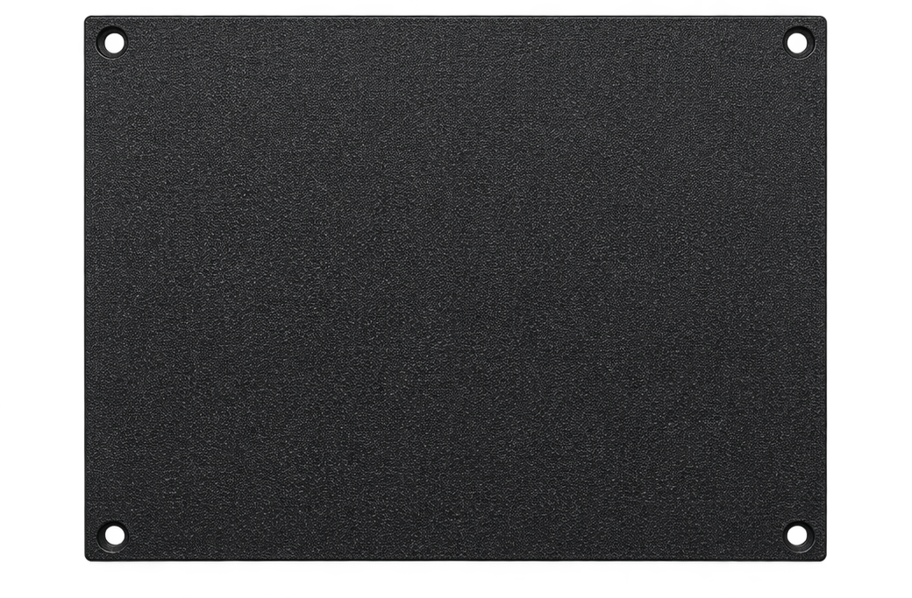 
      Lid
    </td>
    <td align="center">
      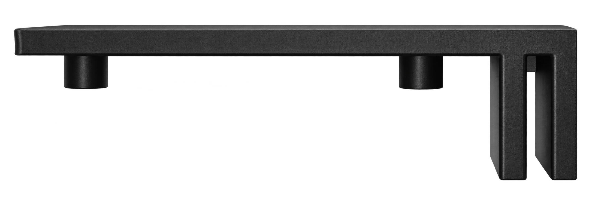 
      Sensor Mount
    </td>
  </tr>
</table>

## OpenSCAD Source Files

The OpenSCAD source files are included in the OpenSCAD directory, allowing you to modify the enclosure or mounting system to suit your specific requirements.

<table align="center">
  <tr>
    <td align="center">
      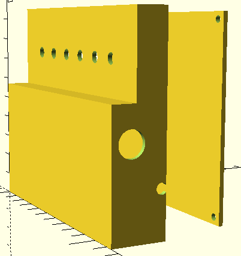 
      OpenSCAD Front View
    </td>
    <td align="center">
      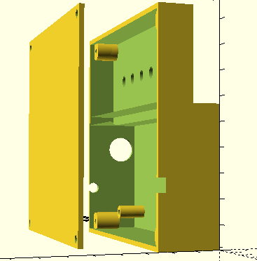 
      OpenSCAD Back View
    </td>
    <td align="center">
      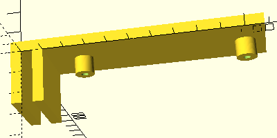 
      OpenSCAD Mounting
    </td>
   </tr>
</table>

## 🛒 Bill of Materials and Links to Purchase

| Item | Purchase Link |
|---|---|
| ESP32 ESP-WROOM-32 Development Board WiFi + Bluetooth | [Amazon](https://link.amazon/B0espH4Ix) |
| PCB Board - Send the  gerbers files in the PCB folder | JLCPCB or PCBWay |
| Right Angle USB C Flat Extension Cable | [Amazon](https://link.amazon/B0bMhexuD) |
| Waterproof Ultrasonic Ranging Sensor | [Amazon](https://link.amazon/B0bCV0Zxt) |
| LED Light Kit Box - 5 Colors | [Amazon](https://link.amazon/B04djoovX) |
| 220 Ohm Resistor 1/2W (0.5 Watt) | [Amazon](https://link.amazon/B0dC10wjN) |
| DC 3-12V Active Electronic Buzzer | [Amazon](https://link.amazon/B0bWC1ZQ9) |
| JST Connector Kit 2.0mm - 2 and 4 Pin | [Amazon](https://link.amazon/B0aqEWpW9) |
| Self Tapping Screw M2x4 | [Amazon](https://link.amazon/B039ca9Il) |
| Bambu Lab PLA 3D Printer Filament 1.75mm RFID | [Amazon](https://link.amazon/B09fCrKce) |

> **Affiliate Disclosure:** Some of the links above are Amazon affiliate links. As an Amazon Associate, I may earn from qualifying purchases at no additional cost to you.

# Quick Start Guide

1. Order the PCB from your preferred manufacturer. The Gerber files included in this repository are production-ready and can be uploaded directly to services such as JLCPCB or PCBWay.

2. Assemble the PCB and install all components, including the ESP32, DFRobot A02YYUW ultrasonic sensor, LEDs, and buzzer.

3. Upload the firmware to the ESP32 using the Arduino IDE via the USB-C port.

4. Power on the device. Using your phone, tablet, or computer, connect to the Wi-Fi hotspot named **Watersensor.local**.

5. The captive portal should open automatically. If it does not, open a web browser and navigate to:

   http://Watersensor.local

6. Enter your home Wi-Fi SSID and password.

7. Configure the water level thresholds in millimetres. The default settings are:
   - Low Water Level: 40 mm
   - High Water Level: 140 mm

8. Click **Save**. The device will reboot and automatically connect to your home Wi-Fi network.

9. Once connected, the web interface can be accessed at any time from any device on your network by visiting:

   http://Watersensor.local

## You're Ready!

The Aquarium Water Level Monitor is now configured and actively monitoring your sump water level. Visual and audible alerts will be triggered whenever the water level falls below your configured minimum threshold, helping you detect evaporation, pump failures, and other water level issues before they become critical.

## Support - Buy Me a Coffee Please

If my work has saved you time, taught you something new, or inspired your own project, consider buying me a coffee. Your support directly helps fund future development and new projects.

☕ Buy Me a Coffee: https://buymeacoffee.com/mattmbyrne

Every contribution helps fund prototyping, PCB manufacturing, testing, and documentation.

## License
This project is licensed under the MIT License - see the LICENSE file for details.

